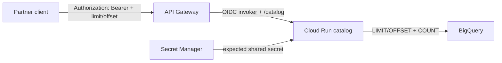
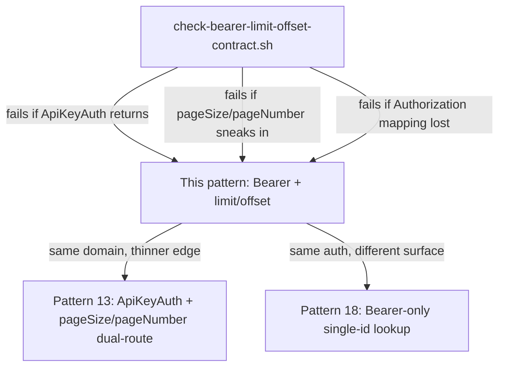
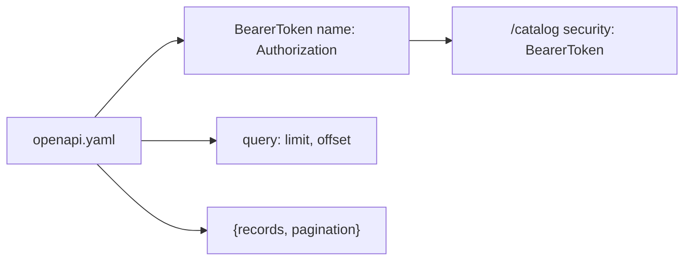
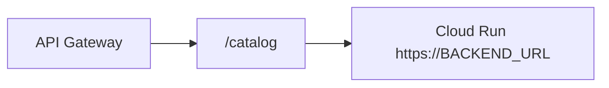

# Architecture: Bearer-only limit/offset catalog gateway

## Components

| Component | Role |
|-----------|------|
| Partner / destination client | Sends `Authorization: Bearer YOUR_API_KEY` + `limit`/`offset` |
| API Gateway | Validates BearerToken; proxies `/catalog` to Cloud Run |
| Shared secret / API & Services key | Credential restricted to this API when using platform keys |
| Cloud Run catalog handler | Path `/catalog`; app-layer secret check; SQL LIMIT/OFFSET |
| Secret Manager | Source of truth for the expected Bearer token value |
| BigQuery (typical) | Parameterized catalog page + COUNT for `pagination.total` |

## Request path

Gateway rejection (missing/invalid platform binding) and handler rejection
(secret mismatch or empty page 404) are different failure domains. Do not
collapse them into one "401 means rotate everything" runbook.

## Auth vs pagination dialects

Keep these three contracts as separate OpenAPI revisions. Overwriting the thin
Bearer catalog YAML with the dual-route ApiKeyAuth revision silently breaks
partner SDKs that still send Authorization + limit/offset.

## Scheme mapping

Swagger 2.0 `apiKey` in `header` with `name: Authorization` is how API Gateway
expresses Bearer shared-secret auth. Keep the scheme **name** and the header
**name** aligned so Swagger UI and codegen do not lie.

## Path backend

`x-google-backend.address` includes the `/catalog` path suffix and
`protocol: h2`. That matches how Cloud Run expects the service to see the path
after gateway proxying.

## IAM checklist

- Gateway SA: `roles/run.invoker` on the Cloud Run service.
- Prefer `--no-allow-unauthenticated` on Cloud Run.
- Restrict platform API keys to this API when you use API & Services keys as
  the Bearer material (or keep Bearer as a Secret Manager value and document
  distribution separately).
- Runtime SA: least privilege on the catalog table only.
- Cap `limit` in the handler even if OpenAPI defaults to 1000.
- Never put real tokens into OpenAPI examples.
