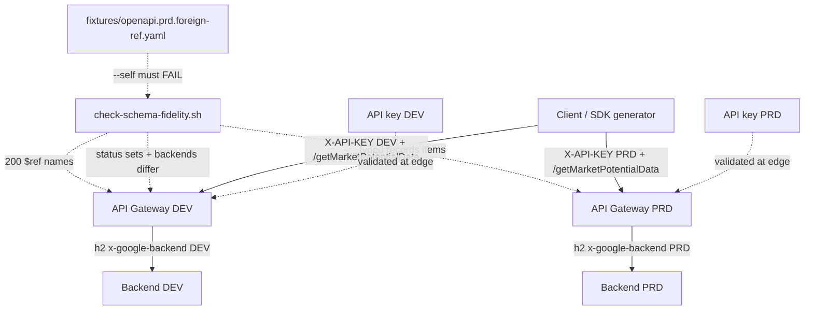
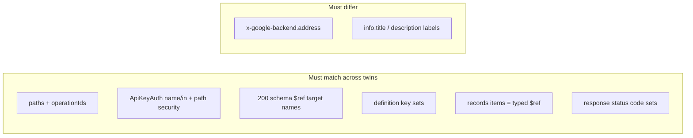

# Architecture: Twin schema fidelity gate

## Components

| Component | Role |
|-----------|------|
| Partner / internal client | Calls the same path against DEV or PRD hostname |
| API Gateway (DEV) | Serves `openapi.dev.yaml`; validates DEV API key |
| API Gateway (PRD) | Serves `openapi.prd.yaml`; validates PRD API key |
| API keys (API & Services) | Separate keys per env; restrict each to its API |
| Cloud Run / Gen2 (DEV) | Dev warehouse extract |
| Cloud Run / Gen2 (PRD) | Prod warehouse extract |
| `check-schema-fidelity.sh` | Deploy gate: `$ref` names, definition keys, typed records, statuses |
| Foreign-ref fixture | Positive control — gate must fail when PRD carries another product's schema |

## Diagram

## What must match vs what must differ

| Surface | Rule |
|---------|------|
| Paths / operationIds | Identical |
| Path-level `security:` | Identical (ApiKeyAuth) |
| 200 `$ref` definition name | Identical — no foreign product leftovers |
| `definitions:` keys | Identical sets |
| `records.items` | `$ref` to a record definition — not `additionalProperties: true` |
| Response status codes | Identical sets per operation |
| `x-google-backend.address` | **Different** (`BACKEND_URL` vs `BACKEND_URL_DEV`) |

## Why this sits next to pattern 11

Pattern 11's `check-twins.sh` already fails many of these cases indirectly when
definition property keys diverge. This folder makes the **schema fidelity**
lesson explicit for pagination extracts: foreign `$ref` names and untyped
record bags are first-class failures, with a fixture that proves the gate
works (`--self` must fail).

## Operability notes

1. Run `./check-schema-fidelity.sh` and `./check-schema-fidelity.sh --self`
   in CI before any `api-configs create`.
2. When you rename a definition, rename it in **both** twins in the same PR.
3. Prefer promoting the typed DEV schema into PRD over "simplifying" PRD back
   to `additionalProperties` to silence generator noise.
4. Handler IAM / table selection remain in the Cloud Run service (pattern 08).
