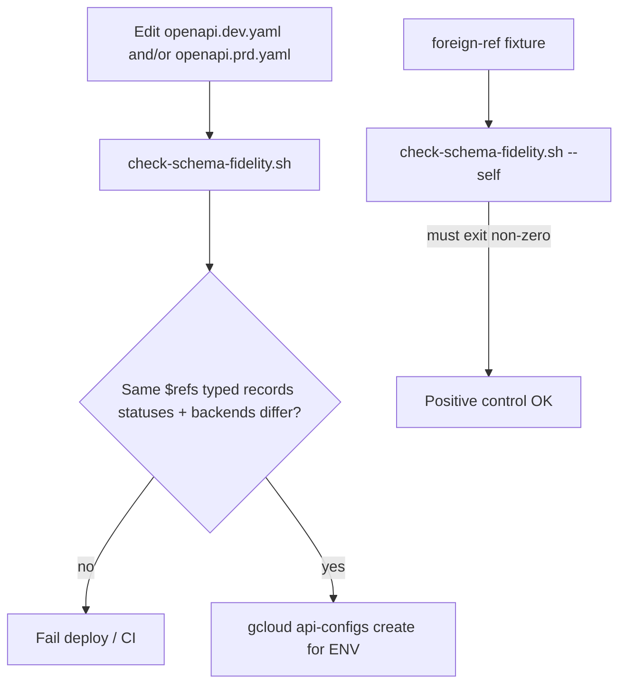
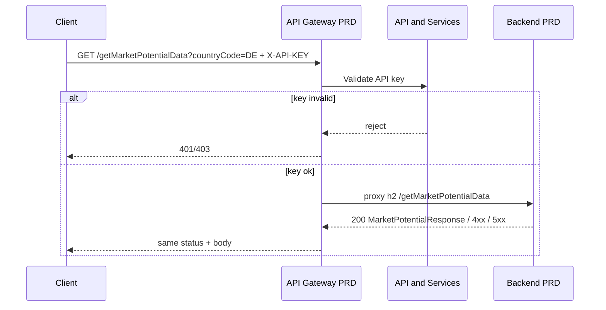

# Data flow: Twin schema fidelity gate

## Happy path (either env)

1. Client picks the env hostname (`GATEWAY_HOST` or `GATEWAY_HOST_DEV`) and the
   matching API key.
2. Client sends
   `GET /getMarketPotentialData?countryCode=DE&pageSize=100&pageNumber=1`
   with header `X-API-KEY: YOUR_API_KEY`.
3. That env's API Gateway validates the key. Missing / invalid → **401/403** at
   the edge (API & Services), not from the OpenAPI status set alone.
4. Gateway proxies over h2 to the env-specific Cloud Run / Gen2 address
   including the `/getMarketPotentialData` leaf.
5. Backend returns `{ records, pagination }` (or 4xx/5xx). Gateway forwards
   status + body.

Path, header name, 200 `$ref` (`MarketPotentialResponse`), and declared status
codes are identical in both twins — only host, key, and backend differ.

## Schema-fidelity gate before deploy

## Sequence (PRD)

## Failure modes

| Symptom | Likely cause | Where to look |
|---------|--------------|---------------|
| Gate fails: 200 `$ref` differ | Copied OpenAPI from another product | Rename both twins to one product-local definition |
| Gate fails: `additionalProperties` | Untyped records bag left on one twin | Point `records.items` at `MarketPotentialRecord` |
| Gate fails: status sets differ | Extra 403/401 documented on one env only | Align declared statuses; keep IAM 403 out of OpenAPI if undocumented on the other twin |
| Gate fails: backends identical | Copied PRD address into DEV | `BACKEND_URL` vs `BACKEND_URL_DEV` |
| `--self` passes | Fixture or script broken | Restore foreign `$ref` / untyped records on the fixture |
| SDK field missing in PRD only | Shipped untyped PRD historically | Promote typed schema; bump API config id |

## Logging

- Do not log full API keys. Prefer key fingerprint / consumer project if the
  gateway exposes it.
- Backend structured logs should include `countryCode`, `pageSize`,
  `pageNumber`, and latency — not raw row payloads at info level.
