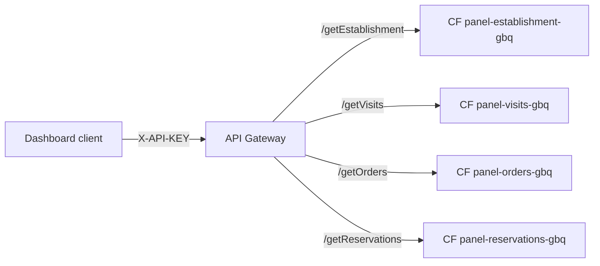
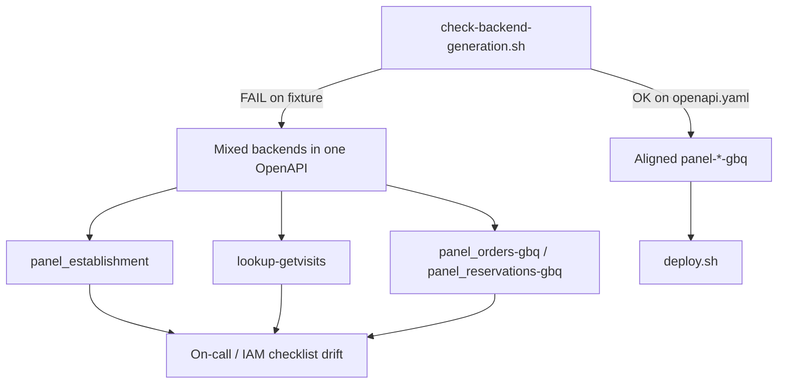
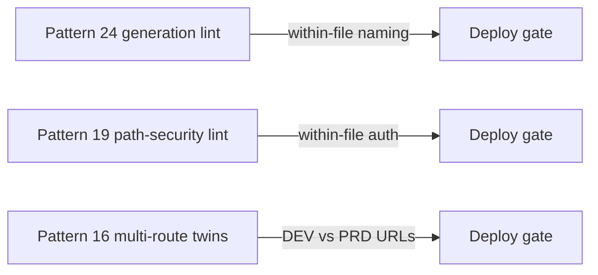

# Architecture: mixed backend generation lint

## Components

| Component | Role |
|-----------|------|
| Dashboard / partner client | Sends `X-API-KEY: YOUR_API_KEY` |
| API Gateway | One hostname; per-path proxy to Cloud Functions |
| Four Cloud Functions | Establishment / visits / orders / reservations — same generation |
| `check-backend-generation.sh` | Pre-deploy gate: family + separator + `-gbq` parity |
| API & Services key | Credential restricted to this API |
| BigQuery (typical) | Parameterized reads behind each migrated function |

## Request path (aligned)

One family (`panel-`), one separator (`-`), one generation suffix (`-gbq`).
Invoker IAM is four grants on the same naming surface.

## The footgun vs the gate

Partial `-gbq` migration and a foreign `lookup-*` visits backend are the same
class of defect: the gateway hostname implies one platform surface, the
addresses do not.

## Relation to other gates

Use this lint on every multi-route OpenAPI PR. Keep pattern 19 for auth wiring.
Add pattern 16 once DEV/PRD twins exist. The three gates answer different
questions; none replaces the others.

## IAM checklist

- Gateway SA: invoker on **each** function (four grants, not one).
- Prefer `--no-allow-unauthenticated` on the functions.
- Restrict platform API keys to this API (see pattern 05).
- Runtime SA: least privilege on the tables each function reads.
- After a generation rename, revoke invoker on the retired function names.
- Never put real keys into OpenAPI examples or the negative fixture.

## Environment separation

Dev and prod differ by project, gateway host, and backend URLs. Keep family /
separator / generation suffix identical across envs even when regions differ.
Do not "temporarily" leave one DEV route on a foreign function name for curl
convenience — that temporary path becomes the production path.
