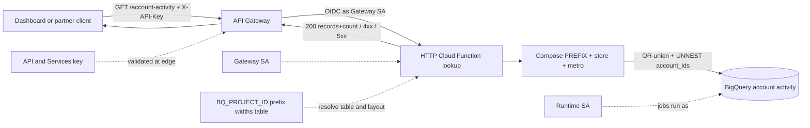
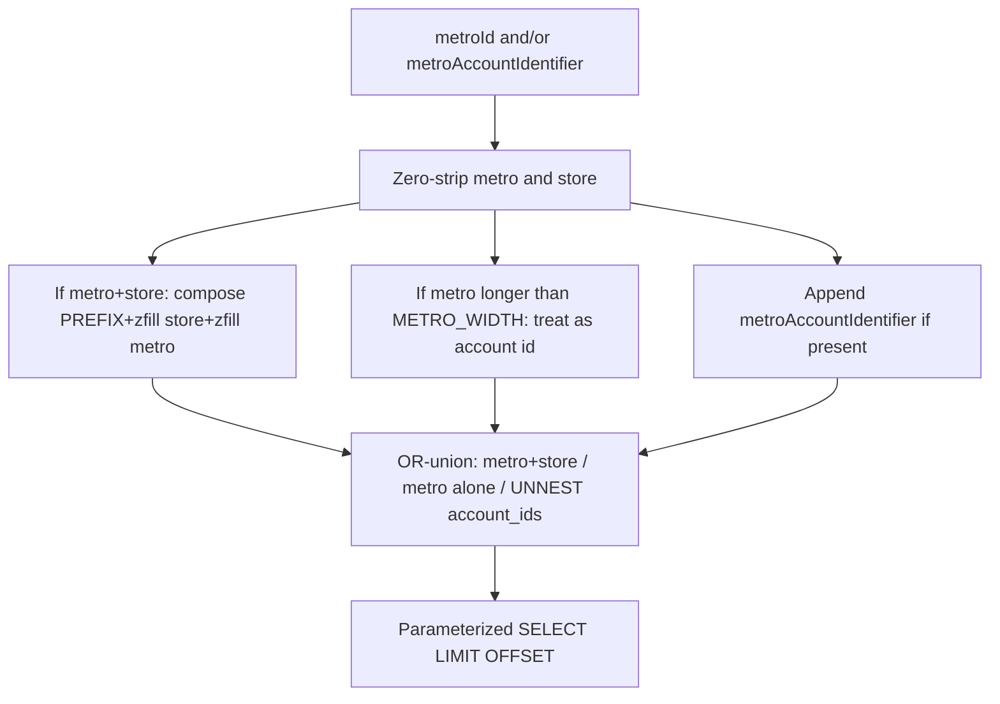

# Architecture: Account-composition DE lookup handler

## Components

| Component | Role |
|-----------|------|
| Dashboard / partner client | Calls HTTPS with `X-API-Key` + metro / account identity + paging |
| API Gateway | Edge OpenAPI, API key validation, path proxy to backend |
| Gateway service account | Invoker identity for Gen2 / Cloud Run |
| HTTP Cloud Function (`lookup`) | Compose ids, OR-union match, query, JSON `{records, count}` |
| `ACCOUNT_ID_PREFIX` / widths | Deploy-time account layout (replaces hard-coded national prefix) |
| `BQ_PROJECT_ID` / table override | Selects which warehouse table the job reads |
| `EXPOSE_ERROR_DETAIL` | Gates whether 500 bodies include exception text |
| Runtime service account | Identity for BigQuery jobs |
| BigQuery | Account activity / lead extract |

## Diagram

## Identity resolution

### Env checklist

| Variable | Required | Notes |
|----------|----------|-------|
| `BQ_PROJECT_ID` | Yes* | Job/billing project; required when table override unset |
| `DATASET_ID` | Recommended | Defaults to placeholder `DATASET_ID` if unset |
| `ACCOUNT_LOOKUP_TABLE` | No | Full `project.dataset.table` override |
| `ACCOUNT_LOOKUP_TABLE_ID` | No | Table leaf when building from project+dataset |
| `ACCOUNT_ID_PREFIX` | Recommended | Country / org prefix; defaults to `COUNTRY_ACCOUNT_PREFIX` |
| `ACCOUNT_STORE_WIDTH` | No | Default `3` |
| `ACCOUNT_METRO_WIDTH` | No | Default `8`; also gates long-metro→account fallback |
| `ACCOUNT_LOOKUP_CREATED_FROM` | No | Date floor (default `2024-02-01`) |
| `EXPOSE_ERROR_DETAIL` | No | `true` / `1` / `yes` only in non-prod |

\* Or set `ACCOUNT_LOOKUP_TABLE` alone.

### IAM checklist

1. Deploy with `--no-allow-unauthenticated`.
2. Grant gateway SA `roles/cloudfunctions.invoker` and Gen2 `roles/run.invoker`.
3. Runtime SA: BigQuery job user + data viewer on the account-activity dataset only.
4. Restrict the edge API key to this API in API & Services.
5. Release gate: confirm `ACCOUNT_ID_PREFIX` / widths match warehouse ETL before traffic.

## Why composition lives in the function

Warehouse extracts often store a single `metro_account_identifier` column while product UIs still speak metro + store. Encoding composition in the backend keeps the OpenAPI contract stable for both client generations and avoids teaching every consumer the national zfill rules. Prefix and widths stay deploy env — not query params — so callers cannot invent layout variants.
