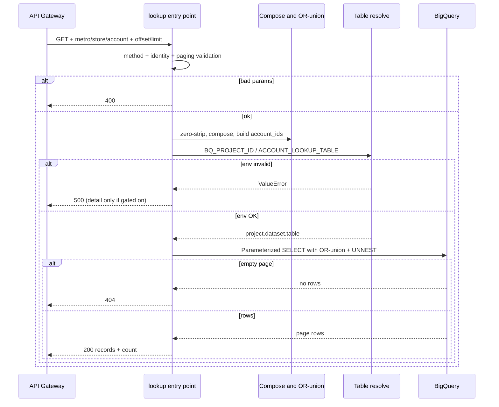

# Data flow: Account-composition DE lookup handler

## Happy path

1. Client calls `GET https://GATEWAY_HOST/account-activity?metroId=154530&storeId=58&offset=0&limit=50` with header `X-API-Key: YOUR_API_KEY`.
2. API Gateway validates the edge key, then proxies with OIDC as the gateway SA.
3. Function:
   - Rejects non-GET with **405**
   - Requires `metroId` and/or `metroAccountIdentifier` (**400** if both missing)
   - Validates `offset` >= 0 and `1 <= limit <= 1000`
   - Zero-strips metro/store; composes `PREFIX + store.zfill(3) + metro.zfill(8)`
   - OR-unions metro+store / metro alone / `UNNEST(@account_ids)`
   - Runs parameterized `SELECT ... LIMIT/OFFSET`
   - Returns `{records: [...], count: N}` on success
4. Gateway returns the same status and body.

Example success body (fake data):

```json
{
  "records": [
    {
      "subject": "Follow-up visit",
      "assigned_id": "U-100",
      "description": "Quarterly check-in",
      "type": "activity",
      "created_date": "2026-09-15",
      "sub_type": "visit",
      "event_topic": "retention",
      "is_closed": false,
      "name_id": "N-200",
      "outcome": "scheduled",
      "activity_id": "A-300",
      "start_date": "2026-09-20",
      "lead_account_id": "L-400",
      "metro_account_identifier": "COUNTRY_ACCOUNT_PREFIX05800154530",
      "user_id": "U-100",
      "profile_name": "field-ops",
      "won_status": "open",
      "metro_id": "154530",
      "store_id": "58"
    }
  ],
  "count": 1
}
```

## Alternate identity paths

| Caller input | What the function does |
|--------------|------------------------|
| `metroId` + `storeId` | Compose account id; match metro+store **or** composed id |
| `metroId` only | Match zero-stripped metro; no composition |
| `metroAccountIdentifier` only | Match that id via UNNEST (no metro predicate) |
| Long `metroId` (> `ACCOUNT_METRO_WIDTH`) | Treat as an account id candidate as well |
| `metroId` + `metroAccountIdentifier` | Union both strategies |

## Failure modes

| Symptom | Likely cause | What to check |
|---------|--------------|---------------|
| 403 from gateway | Edge API key / restriction | API & Services key config |
| 403 from backend | Invoker IAM | Gateway SA functions + run invoker |
| 400 identity | Missing metroId and metroAccountIdentifier | Query param names |
| 400 paging | Non-int, offset &lt; 0, limit out of range | Client params; MAX_LIMIT=1000 |
| 404 data | Unknown id, wrong prefix, or page past end | `ACCOUNT_ID_PREFIX` / widths vs ETL; filters |
| 500 env | Missing `BQ_PROJECT_ID` / bad table | Cloud Run env on the revision |
| 500 BQ | Permissions / bad table / override typo | Runtime SA roles; logged resolved table |
| 500 with `detail` | `EXPOSE_ERROR_DETAIL` enabled | Expected in staging only |

## Logging

Log zero-stripped metro/store, the deduped `account_ids` list, offset, limit, and resolved table. Never log API keys, Authorization headers, or raw request dumps that could include PII beyond the identity keys already required for the query.

When `EXPOSE_ERROR_DETAIL` is off, 500 bodies stay generic while Cloud Logging still gets `logger.exception`.

## Sequence (function-local)



## Contract note vs pattern 09

Pattern 09 **rejects** metro without store (400 pair check) and ANDs filters. This pattern **accepts** metro alone, composes when store is present, and OR-unions strategies so a composed-id caller and a metro+store caller can share one route. Do not reuse the tickets OpenAPI pair-check semantics here.
