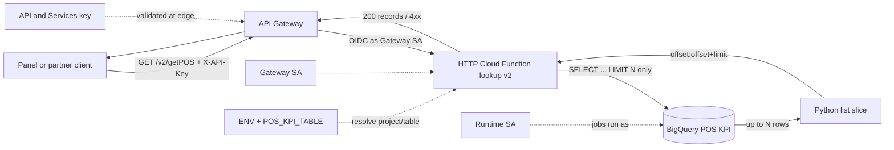
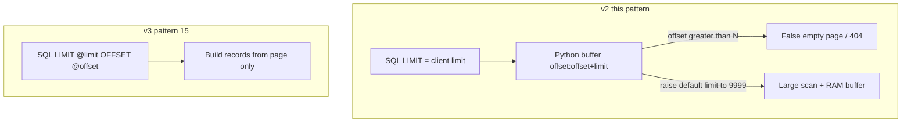

# Architecture: POS KPI in-memory slice pagination (legacy)

## Components

| Component | Role |
|-----------|------|
| Panel / partner client | Still calls `/v2/getPOS` during migration |
| API Gateway | Edge OpenAPI, API key validation, path proxy |
| Gateway service account | Invoker identity for Gen2 / Cloud Run |
| HTTP Cloud Function (`lookup`) | Legacy body: LIMIT in BQ, slice in Python |
| `ENV` / `POS_KPI_TABLE` | Opaque project name + optional table override |
| Runtime service account | Identity for BigQuery jobs |
| BigQuery | POS KPI snapshot / mart |
| Smell gate script | CI check against *other* handlers (and `--self`) |

## Diagram

## Why this burns money and correctness

### Env checklist (legacy)

| Variable | Required | Notes |
|----------|----------|-------|
| `ENV` | Yes* | Legacy name for the BigQuery *project* — prefer `BQ_PROJECT_ID` on new code |
| `DATASET_ID` | Recommended | Used when `POS_KPI_TABLE` unset |
| `POS_KPI_TABLE` | No | Full `project.dataset.table` or `dataset.table` override |
| `POS_KPI_TABLE_ID` | No | Table leaf when building from dataset |

\* Or set `POS_KPI_TABLE` to a fully qualified table and still expect `ENV` if the Client needs an explicit project.

### IAM checklist

1. Deploy with `--no-allow-unauthenticated`.
2. Grant gateway SA `roles/cloudfunctions.invoker` and Gen2 `roles/run.invoker`.
3. Runtime SA: BigQuery job user + data viewer on the POS KPI dataset only.
4. Restrict the edge API key to this API in API & Services.
5. Plan retirement: flip `/v2/getPOS` traffic to pattern 15 or delete the path after clients migrate.

## Operability note

Memory sizing on this revision often crept from 256Mi toward 512Mi+ because the default limit pulled large buffers. That is a smell, not a capacity plan — fix the query shape instead of forever raising memory.
