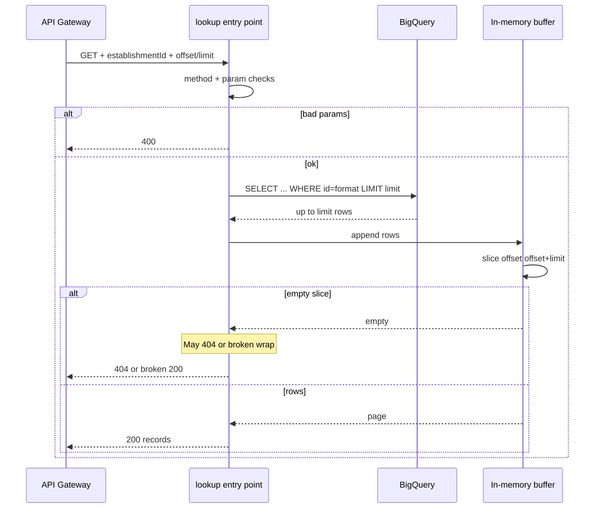

# Data flow: POS KPI in-memory slice pagination (legacy)

## Happy path (page 0 only is reliable)

1. Client calls `GET https://GATEWAY_HOST/v2/getPOS?establishmentId=EST-1001&offset=0&limit=20` with header `X-API-Key: YOUR_API_KEY`.
2. API Gateway validates the edge key, then proxies with OIDC as the gateway SA.
3. Function:
   - Rejects non-GET with **403** (legacy status; pattern 15 uses 405)
   - Requires `establishmentId`
   - Builds SQL with format-string `WHERE` + `LIMIT {limit}` (no `OFFSET`)
   - Loads up to `limit` rows into a Python list
   - Slices `buffer[offset:offset+limit]`
   - Returns `{records: [...]}` when the slice is non-empty
4. Gateway returns the same status and body.

Example success body (fake data):

```json
{
  "records": [
    {
      "persistence_id": "p-10001",
      "establishment_id": "EST-1001",
      "asset_created_date": "2024-01-15",
      "created_at": "2024-01-15T10:00:00",
      "turnover_current_month": 12000,
      "turnover_week_1": 3000,
      "turnover_week_2": 2800,
      "turnover_week_3": 3100,
      "turnover_week_4": 3100,
      "turnover_percentage_change": 5,
      "completed_orders": 420,
      "percentage_change": 3,
      "completed_orders_by_contact": 40,
      "completed_orders_by_card": 200,
      "completed_orders_by_online": 150,
      "completed_orders_by_invoice": 30,
      "turnover_last_month": 11000,
      "completed_orders_last_month": 400
    }
  ]
}
```

## Failure modes and false negatives

| Symptom | Likely cause | What to check |
|---------|--------------|---------------|
| 403 from gateway | Edge API key / restriction | API & Services key config |
| 403 from backend | Invoker IAM **or** non-GET | Method; gateway SA bindings |
| 400 establishmentId | Missing / blank | Query param name is `establishmentId` |
| 404 on page 2+ with small limit | `offset >= LIMIT` after warehouse truncate | Classic in-memory-slice bug — move to pattern 15 |
| 404 on real BQ/config errors | Bare `except` collapses failures | Cloud Logging; never trust 404 alone on this revision |
| Odd 200 body on empty page | Double-`jsonify` of a `(Response, 404)` tuple | Known defect in `lookup` — see `main.py` |
| High BQ bytes / CF memory | Default `limit=9999` | Client defaults; memory limit creep |
| Dates ignored | `startDate`/`endDate` unused | Do not promise date filters on v2 |

## Sequence (function-local)



## Logging

Log resolved table, offset, and limit. Do not log API keys. Prefer not logging fully interpolated SQL (this museum handler avoids printing the query string; the format-string construction is still unsafe).

## Migration path

1. Deploy pattern 15 as `/v3/getPOS` (or retarget the v3 backend address).
2. Move clients off `/v2/getPOS`.
3. Run `check-inmemory-slice-smell.sh` against remaining handlers in CI.
4. Delete or freeze this revision once traffic is zero.
